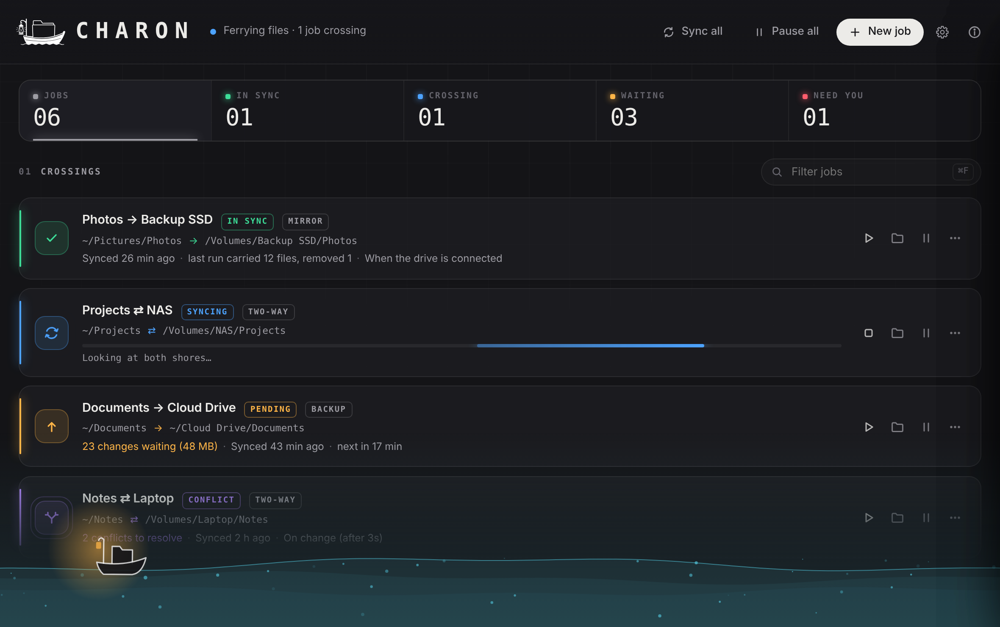

<p align="center">
  
  
</p>

<h1 align="center">Charon</h1>

<p align="center">
  <strong>The ferryman for your files.</strong><br>
  Sync jobs between folders and drives: mirror, backup or two-way, by hand, on change,
  on a schedule or the moment a drive is plugged in. Nothing is lost on the crossing.
</p>

<p align="center">
  <a href="../../releases/latest">Download</a> ·
  <a href="https://charonsync.app">Website</a> ·
  <a href="docs/DEVELOPMENT.md">Build from source</a>
</p>

<p align="center">
  
  
  
  
</p>



---

## What it does

A **sync job** connects two folders: a source and a destination. Each job is one row in
Charon's window, with its status, a progress bar while it runs, when it last synced and what's
waiting, and buttons to sync now, open either folder, or pause it.

**Three ways to cross**

| Mode | What happens |
|---|---|
| **Mirror** | The destination becomes an exact copy of the source. Deletions carry over. |
| **Backup** | New and changed files are copied. Nothing is ever deleted on the destination. |
| **Two-way** | Changes flow both ways. Charon remembers the last synced state, so it can tell "deleted here" from "new there". |

**Four ways to start**

- **Manual:** only when you press *Sync now*.
- **On change:** a few seconds after edits in the folder settle down.
- **On a schedule:** every *N* minutes, or every day at a set time.
- **When the drive is connected:** plug in the backup drive and it just syncs.

## Status at a glance

Every row uses a colour *and* an icon, so it still reads for colour-blind eyes.

| | Status | Meaning |
|:---:|---|---|
| 🟢 | In sync | Both folders match |
| 🔵 | Syncing | Files are crossing right now |
| 🟠 | Pending | Changes are waiting to cross |
| ⚪ | Paused | Won't run by itself (*Sync now* still works) |
| 🟣 | Conflict | A file changed on both sides and needs your decision |
| 🔴 | Error | The last run failed, or some files couldn't be copied |
| ⚫ | Offline | A folder or its drive isn't reachable |

## Built to be trusted

- **Preview before you sync.** A dry run shows exactly what will be copied, replaced and
  removed (*"23 files, 48 MB, remove 3"*) before anything is touched. New jobs open it by
  themselves.
- **Safe deletes.** Removed and overwritten files go to a `.charon-trash` folder for 30 days
  (configurable) instead of disappearing.
- **No half-written files.** Each file is copied to a temporary name first and only takes its
  real name once it's complete, with its original modification time.
- **Stops before disaster.** If one side is suddenly empty (an unmounted drive, a wrong
  folder), Charon refuses to wipe the other side.
- **Conflicts are never silent.** For two-way jobs, choose per job: keep both versions, newest
  wins, or ask you. An edit always beats a deletion.
- **Exclude filters.** `.DS_Store`, `Thumbs.db` and friends are left out by default; add your
  own patterns like `node_modules` or `*.tmp`.

## More

- Lives in the **menu bar** or system tray, with the overall status and *Sync all* / *Pause
  everything*.
- **Notifications** for errors, conflicts and big syncs. Small routine syncs stay silent.
- **Launch at login**, and keeps running when the window is closed.
- A **per-job activity log**: what each run copied, and which files failed and why.
- **macOS, Windows and Linux.**

## Install

Download the latest version for your system from the [**Releases**](../../releases/latest) page:

| System | File |
|---|---|
| macOS (Apple Silicon) | `Charon-macOS-Apple-Silicon.dmg` |
| macOS (Intel) | `Charon-macOS-Intel.dmg` |
| Windows | `Charon-Windows-Setup.exe` or `Charon-Windows.msi` |
| Linux | `Charon-Linux.AppImage` (any distribution), `.deb` (Debian, Ubuntu) or `.rpm` (Fedora, openSUSE) |

> **First start:** the macOS version is signed and notarised by Apple. The Windows installers
> aren't signed yet: choose **More info → Run anyway** if SmartScreen asks.
> On Linux, the tray icon needs AppIndicator support (on GNOME: the "AppIndicator" extension).

## Privacy

Charon works entirely on your computer. No accounts, no cloud, no tracking, no analytics.
Your jobs and settings stay in a small file in the app's data folder.

## Build from source

Charon is written in Rust with [Tauri](https://tauri.app); the interface is plain HTML, CSS and
JavaScript, with no Node.js needed.

```sh
cargo install tauri-cli --version "^2" --locked
cargo tauri dev       # run it
cargo tauri build     # make installers for your system
```

See [**docs/DEVELOPMENT.md**](docs/DEVELOPMENT.md) for requirements per system, the project
layout and how the sync engine decides what to do.

## Contributing

Bug reports, ideas and pull requests are welcome. See [CONTRIBUTING.md](CONTRIBUTING.md), and
please open an issue first for bigger changes.

## Licence

[MIT](LICENSE) © 2026 [DigiFix S.à r.l.-S.](https://digifix.ninja)
